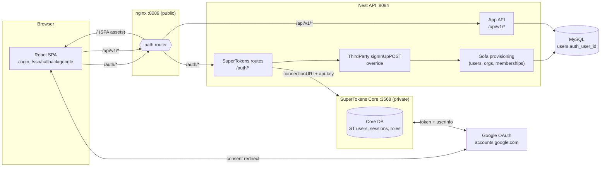
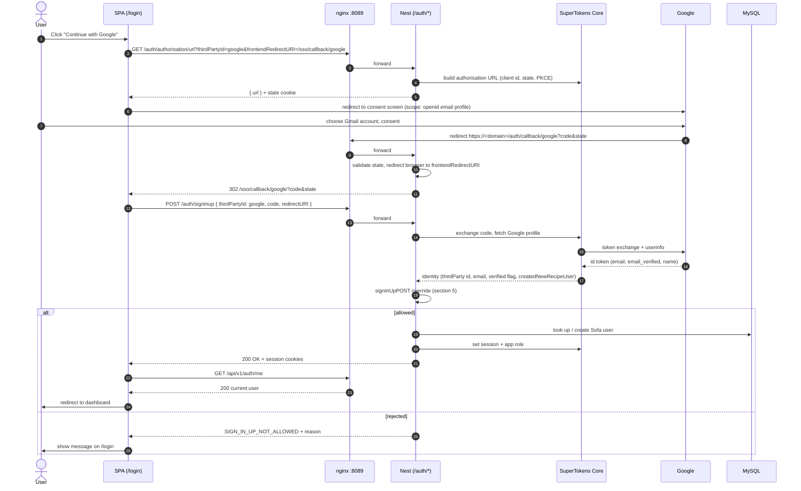
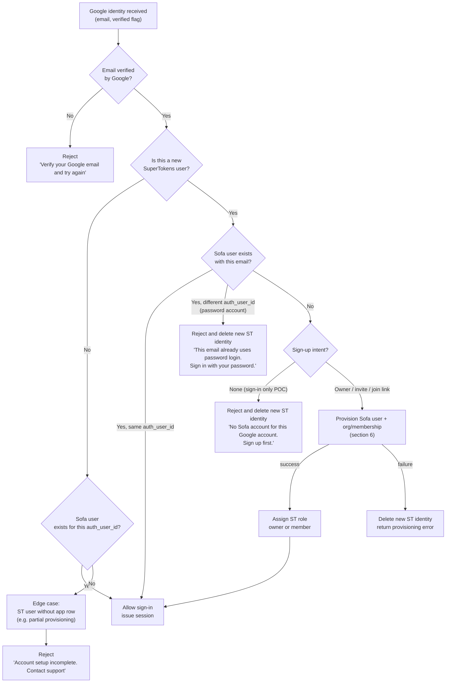

# Google SSO (Gmail) — POC Plan

Proof of concept for letting Sofa users sign in with a Google account (consumer Gmail) through SuperTokens **ThirdParty** recipe, alongside the existing email and password login.

| | |
|---|---|
| **Status** | Draft, awaiting decisions in [section 13](#13-open-decisions) |
| **Owner** | TBD |
| **Related** | [`supertokens-setup.md`](./supertokens-setup.md), [`go-live-security.md`](./go-live-security.md) |
| **Code touched** | `supertokens.config.ts`, `init-supertokens.ts`, `auth-api.ts`, login/sign-up pages (auth code, needs explicit approval) |

---

## Table of contents

1. [Goal and scope](#1-goal-and-scope)
2. [Current state](#2-current-state)
3. [Target architecture](#3-target-architecture)
4. [Sign-in sequence](#4-sign-in-sequence)
5. [Decision flow after Google returns](#5-decision-flow-after-google-returns)
6. [Provisioning options](#6-provisioning-options)
7. [Account linking and duplicate emails](#7-account-linking-and-duplicate-emails)
8. [Implementation plan](#8-implementation-plan)
9. [Configuration](#9-configuration)
10. [Google requirements for production](#10-google-requirements-for-production)
11. [Edge cases](#11-edge-cases)
12. [Test plan and acceptance](#12-test-plan-and-acceptance)
13. [Open decisions](#13-open-decisions)
14. [Risks](#14-risks)
15. [Production go-live checklist (Google SSO)](#15-production-go-live-checklist-google-sso)
16. [Rollback](#16-rollback)

---

## 1. Goal and scope

**Goal:** a user clicks **Continue with Google** on `/login` and gets the same SuperTokens session they get from email and password. Sofa RBAC does not change.

### In scope

- Google as the only provider, for consumer Gmail accounts.
- Sign-in for users who already have a Sofa account.
- Sign-up paths (owner, invitation, join link), phased in after the sign-in POC.
- Production-ready Google Cloud configuration.

### Out of scope

- Other providers (Microsoft, GitHub, Apple).
- Google Workspace domain restriction (`hd` parameter). Possible later.
- SAML or enterprise SSO.
- Any change to permissions. Fine-grained RBAC stays in MySQL. SuperTokens keeps only `superadmin | owner | member`.

---

## 2. Current state

| Area | Today | Source |
|---|---|---|
| SuperTokens recipes | EmailPassword, Session, UserMetadata, UserRoles, Dashboard | `tickets_backend_v2/src/config/supertokens.config.ts` |
| Sign-up | `signUpPOST` override provisions the Sofa user and org. Deletes the ST user if provisioning fails. | same file |
| Identity link | MySQL `users.auth_user_id` = SuperTokens user id. No `password_hash`. | `users` entity |
| Routing | Browser → nginx → Nest `/auth/*` → SuperTokens Core. Browser never talks to Core. | `docs/supertokens-setup.md` |
| Frontend | `supertokens-web-js@^0.16`, custom UI (no prebuilt widgets) | `sofa-frontend/package.json` |
| Roles | `owner` on org sign-up, `member` on invite or join, `superadmin` by hand | `docs/supertokens-setup.md` §5 |

**No schema change is expected.** `users.auth_user_id` already identifies the SuperTokens user regardless of login method. If a schema change becomes necessary, it must be approved first (see `database-changes-and-migrations.mdc`).

---

## 3. Target architecture



**Rules that must hold**

- Google's redirect goes to **Nest** through nginx (`/auth/*`). The SPA only receives the browser after Nest has handled the callback.
- Core stays private. Only Nest talks to it.
- Sofa provisioning runs inside Nest, next to the MySQL writes.

---

## 4. Sign-in sequence



> **Note on the callback path.** An earlier draft suggested Google redirects straight to a SPA route. With nginx sending all `/auth/*` to Nest, the Google redirect must target the Nest callback path (`/auth/callback/google`). Nest then forwards the browser to the SPA route. Confirm the exact redirect behaviour against the SuperTokens docs for the pinned `supertokens-node@^24.1.0` and `supertokens-web-js@^0.16` in Phase 1.

---

## 5. Decision flow after Google returns

This runs inside the `signInUpPOST` override on the Nest side.



**Rule:** any path that rejects a **new** SuperTokens identity must delete it. This matches the existing email and password sign-up behaviour and avoids login accounts with no Sofa row.

---

## 6. Provisioning options

Google sign-in has no form, so a new Google user arrives with only an email and a name. Sofa needs an org or a membership before the user can do anything.

| Option | How | Pros | Cons |
|---|---|---|---|
| **A. Intent before redirect** (recommended for full parity) | Before redirecting to Google, the SPA stores a non-secret intent in `sessionStorage`: `{ type: "owner", orgName }`, `{ type: "invite", token }` or `{ type: "joinLink", token }`. After the callback, Nest reads the intent and provisions. | Matches email sign-up UX. | Intent must travel through the redirect, so validate it server-side. Needs a cleanup path if provisioning fails after the session exists. |
| **B. Sign-in only** (recommended for the POC) | `signInUpPOST` rejects new Google users. Users sign up with email first. | Smallest, safest change. Proves the OAuth round trip. | Google-first users cannot create an org. |

**Plan:** build **B** in the POC to prove the round trip. Build **A** in Phase 5 for owner, invite and join-link sign-up.

### Intent contract (Option A, for later)

| Field | Owner | Invite | Join link |
|---|---|---|---|
| `type` | `owner` | `invite` | `joinLink` |
| `orgName` | required | — | — |
| `token` | — | invitation token | join-link token |
| Validated by | Nest | Nest (token lookup, email must match Google email) | Nest (token lookup) |
| ST role on success | `owner` | `member` | `member` only if `JOINED`, none if approval pending |

Invitations pin the email to the invited address. Google sign-in must match it, or be rejected.

---

## 7. Account linking and duplicate emails

A user may already have a password account and then click Google with the same Gmail address. SuperTokens treats the Google identity as a **different** auth user, so you could end up with two ST users for one email.

**POC rule (no linking):** reject with a clear message (decision flow, section 5).

**Later option:** SuperTokens account linking, which merges identities that share a verified email. Before relying on it, confirm:

- Whether it is available on self-hosted Core under the current license.
- How it interacts with `users.auth_user_id` (one Sofa user, one auth user id).
- Whether it can link an unverified email. It must not.

Only trust the Google identity when `email_verified` is `true`.

---

## 8. Implementation plan

### 8.1 Backend (Nest)

**File:** `tickets_backend_v2/src/config/supertokens.config.ts` (auth code, requires approval)

1. Import `ThirdParty` from `supertokens-node/recipe/thirdparty`.
2. Add it to `recipeList` next to `EmailPassword.init`.
3. Configure the Google provider with credentials from `EnvService`.
4. Add a `signInUpPOST` override that applies the decision flow.

```ts
// Sketch only. Confirm field names against the supertokens-node 24 types before coding.
ThirdParty.init({
  signInAndUpFeature: {
    providers: [
      ThirdParty.Google({
        clientId: env.get('GOOGLE_CLIENT_ID'),
        clientSecret: env.get('GOOGLE_CLIENT_SECRET'),
      }),
    ],
  },
  override: {
    apis: (originalImplementation) => ({
      ...originalImplementation,
      signInUpPOST: async function (input) {
        const response = await originalImplementation.signInUpPOST!(input);
        if (response.status !== 'OK') {
          return response;
        }

        // 1. Reject unverified Google emails.
        // 2. If response.createdNewRecipeUser, look up Sofa user by email.
        //    - Same auth_user_id or no conflict: continue.
        //    - Conflict with a password account: delete the new ST user, return SIGN_IN_UP_NOT_ALLOWED.
        //    - No intent (POC): delete the new ST user, return SIGN_IN_UP_NOT_ALLOWED.
        // 3. Return response.
        return response;
      },
    }),
  },
}),
```

Behaviour rules:

- Every rejection that happens after a new ST user is created must call `SuperTokens.deleteUser(response.user.id)`.
- Errors use `HttpException` with explicit status, per `service-error-handling.mdc`.
- Log the provider user id and email domain only. Never log tokens.
- Google sign-up path (Option A) runs its own service method with a try/catch and `rethrowServiceError`.

### 8.2 Frontend (SPA)

| File | Change |
|---|---|
| `src/config/init-supertokens.ts` | Add `ThirdParty.init()` from `supertokens-web-js/recipe/thirdparty`. |
| `src/features/auth/api/auth-api.ts` | Add `startGoogleSignIn(frontendRedirectURI)` and `completeGoogleSignIn()` wrappers. |
| `src/routes/sso.callback.google.tsx` (new) | Calls `signInAndUp()`, then routes to the app or shows an error. Route path `/sso/callback/google`. |
| `login-page.tsx`, sign-up pages | Add a "Continue with Google" button. Disable while redirecting. |
| `join-organization-page.tsx`, invite pages | Phase 5 only. Store the intent before redirecting. |

Rules:

- No tokens in `localStorage` or `sessionStorage`. The only thing stored is the intent (Phase 5), with no secrets.
- After success, reuse the existing session boot path (`Session.doesSessionExist()` + `/api/v1/auth/me`).

### 8.3 Edge (nginx)

- `/auth/*` → Nest (already in place). Covers the Google callback.
- `/sso/*` → SPA (serve `index.html`, same as other SPA routes).
- No new upstream.

---

## 9. Configuration

### New environment variables (Nest)

| Variable | Example | Notes |
|---|---|---|
| `GOOGLE_CLIENT_ID` | `123-abc.apps.googleusercontent.com` | Per environment. |
| `GOOGLE_CLIENT_SECRET` | `GOCSPX-…` | Secret. Vault or platform secrets only. Never commit. |

### Existing variables that must stay consistent

| Variable | Requirement |
|---|---|
| `SUPERTOKENS_API_DOMAIN` | Public origin (`https://<prod-domain>`), same as the Google redirect host. |
| `SUPERTOKENS_API_BASE_PATH` | `/auth`. |
| `PUBLIC_APP_URL` | Used for `frontendRedirectURI` allow-listing. |
| `VITE_SUPERTOKENS_API_DOMAIN` | Same as `SUPERTOKENS_API_DOMAIN`. |

### Environment matrix

| Env | Google client | Redirect URI |
|---|---|---|
| Local | `sofa-local` | `http://localhost:8089/auth/callback/google` |
| Staging | `sofa-staging` | `https://staging.<domain>/auth/callback/google` |
| Production | `sofa-prod` | `https://<prod-domain>/auth/callback/google` |

Do **not** share one client across environments.

---

## 10. Google requirements for production

Google changes its console wording and policies often. Items marked *(verify)* must be re-checked against the live console and Google's OAuth documentation before launch.

### 10.1 Lead times (start these first)

| Item | Typical wait | Blocks |
|---|---|---|
| Production domain DNS and TLS | Hours | Everything else |
| Domain ownership verification in Google Search Console | Minutes to hours | Consent screen publishing |
| Public home page, privacy policy and terms pages live | Our work, days | Consent screen publishing |
| Brand verification (only if you upload a logo or custom branding) | Days to weeks *(verify)* | Removing the "unverified" warning |
| Redirect URI changes taking effect in Google | 5 minutes to a few hours | Testing a new environment |

**Tip:** submit the consent screen early and **skip the logo at first**. A logo triggers brand verification. You can add it after launch.

### 10.2 Google account and project ownership

- [ ] Use a **company-owned** Google account, not a personal one, as project owner.
- [ ] Add at least **two owners** so access does not depend on one person.
- [ ] Turn on **2-Step Verification** for every owner and editor.
- [ ] Create **one Google Cloud project per environment**: `sofa-local`, `sofa-staging`, `sofa-prod`.
- [ ] No billing account is needed for Google Sign-In. Do not enable billing unless something else needs it.
- [ ] Do not create service accounts or enable extra APIs. Sign-In needs neither.
- [ ] Restrict IAM, and keep audit logs on for the prod project.

### 10.3 Domain ownership

- [ ] Own a production domain, for example `app.sofa.com`.
- [ ] Verify it in **Google Search Console**, using the same Google account that owns the Cloud project, or add that account as an owner.
- [ ] Add the domain under **Authorised domains** on the consent screen.
- [ ] Authorised domains must be real top-level domains. No IP addresses and no `localhost`.

### 10.4 Branding (consent screen)

| Field | Requirement |
|---|---|
| App name | Matches what users see in Sofa. Must not impersonate another brand or contain "Google". |
| User support email | Monitored mailbox, ideally a shared address like `support@…`. |
| App logo *(optional)* | 120×120 px, JPG or PNG, under 1 MB. Triggers brand verification, so add it later. |
| Application home page | Public, on the authorised domain, describes the app. It cannot be only a login wall. |
| Privacy policy URL | Public, on the authorised domain, linked from the home page. |
| Terms of service URL | Recommended. Public, same domain. |
| Developer contact email | Monitored. Google sends policy and verification notices here. |

### 10.5 Audience and publishing

- [ ] User type: **External**. Gmail accounts need it. "Internal" is only for Workspace organisations.
- [ ] Publishing status: **In production**. In **Testing**, only listed test users can sign in and the cap is 100 users.
- [ ] Do not leave the app in Testing at launch. Sign-in will fail for everyone else.

### 10.6 Scopes (Data access)

| Scope | Why | Class |
|---|---|---|
| `openid` | Standard identity token | Non-sensitive |
| `.../auth/userinfo.email` | Email for matching Sofa users | Non-sensitive |
| `.../auth/userinfo.profile` | Name for display and metadata | Non-sensitive |

- [ ] Request **only** these three. Anything else (Drive, Gmail, Calendar) is sensitive or restricted and triggers a full Google verification review, which can take weeks.
- [ ] Re-check the console warning before publishing. It tells you if verification is required.
- [ ] Changing scopes or branding later may trigger re-verification.

### 10.7 Privacy policy and terms content

The privacy policy must be accurate for what Sofa actually does:

- [ ] What Google data is collected: email, name, profile picture, Google account id.
- [ ] Why it is collected: authentication and account creation.
- [ ] Who it is shared with (sub-processors, hosting).
- [ ] How long it is kept, and how a user can delete their account and data.
- [ ] Contact for privacy requests.
- [ ] Compliance wording for the markets you serve (for example GDPR, India's DPDP Act). Have legal review it.
- [ ] A statement that Sofa's use of Google data follows the **Google API Services User Data Policy**.

### 10.8 OAuth client

| Setting | Value |
|---|---|
| Application type | Web application |
| Authorised JavaScript origins | `https://<prod-domain>` |
| Authorised redirect URIs | `https://<prod-domain>/auth/callback/google` |

Google's redirect rules:

- [ ] HTTPS only in production. `http://localhost` is allowed for local only.
- [ ] No wildcards, no fragments, no raw IP addresses (except localhost).
- [ ] The URI must match **exactly**, including scheme, host, path and trailing slash.
- [ ] One client per environment. Never add prod and staging URIs to the same client.
- [ ] Client secrets may only be shown or downloadable **at creation** *(verify)*. Copy to the secret manager immediately.
- [ ] A client can have more than one secret, which allows rotation without downtime *(verify)*.
- [ ] Clients unused for a long period can be removed by Google *(verify)*. Keep staging in regular use.
- [ ] Test users (Testing status only): add your own Gmail accounts if you need to test before publishing.

### 10.9 Google policies that affect Sofa

| Policy | What it means for us |
|---|---|
| **OAuth 2.0 policies** | Use the standard browser redirect flow. Never collect Google passwords. |
| **No embedded web views** | Google blocks sign-in inside embedded browsers (`disallowed_useragent`). The **browser extension** cannot run Google login in an embedded view. Use `chrome.identity` or open a normal browser tab. Treat extension SSO as a separate task. |
| **API Services User Data Policy** | Only use Google data for what the consent screen says. No selling, no ad targeting. |
| **Branding rules** | Follow Google's official "Sign in with Google" button guidelines for the button's look. |
| **Verification emails** | Respond within the deadline. Unanswered notices can get the app suspended. |

---

## 11. Edge cases

| # | Case | Expected behaviour |
|---|---|---|
| E1 | User cancels on Google consent | Browser returns to `/login` with a message. No ST user created. |
| E2 | Google email not verified | Reject. "Verify your Google email and try again." |
| E3 | Google email matches a password account | Reject, delete new ST identity. Tell user to use password. |
| E4 | Brand-new Google user, sign-in only (POC) | Reject, delete new ST identity. "Sign up first." |
| E5 | Existing Google user signs in again | Allow. Session issued. |
| E6 | Google user has ST identity but no Sofa row (partial failure) | Reject with a support message. Log for ops. |
| E7 | State mismatch or replayed callback | ST rejects. SPA shows "Sign-in expired. Try again." |
| E8 | Provisioning fails (Option A) | Delete new ST identity. Return error. No session. |
| E9 | Invite email differs from Google email (Option A) | Reject. "Use the invited email address." |
| E10 | Google outage or token exchange failure | Show retry message. Log with request id. No stack trace to user. |
| E11 | User disables Google access, then signs in | Google refuses. Show "Google sign-in failed." |
| E12 | Same person, two Gmail accounts | Two Sofa accounts. Expected. |

---

## 12. Test plan and acceptance

### Automated

- Unit tests for the `signInUpPOST` decision function, one per branch in section 5.
- Service tests for the Option A intent handling (Phase 5).
- Tests live under `tests/`, mirroring source paths, per `module-folder-structure.mdc`.

### Manual (local, then staging)

| # | Scenario | Pass when |
|---|---|---|
| M1 | Existing owner signs in with Google (same email, linked) | Dashboard loads. `/api/v1/auth/me` returns 200. |
| M2 | Password user, Google with same email | Clear message. No second ST user in dashboard. |
| M3 | New Gmail, sign-in only | Clear message. No ST user left in dashboard. |
| M4 | Cancel at consent | Back on login. No error page. |
| M5 | Sign-out then sign-in again | Works without re-consent prompt (in most cases). |
| M6 | Session expiry and refresh | Same behaviour as password login. |
| M7 | Dashboard user list | ST user shows the Google provider. |

### Acceptance for POC

- M1 to M4 pass on local and staging, with a real Gmail account.
- No token appears in web storage (DevTools check).
- Cookies are `HttpOnly`, and `Secure` on HTTPS.
- Google client secret is not in the repo or logs.

---

## 13. Open decisions

| # | Question | Recommended |
|---|---|---|
| D1 | Can Google users create a new organisation as owner? | **No for the POC.** Yes later, via Option A. |
| D2 | Duplicate email with a password account: block or link? | **Block** with a message. Linking later, after checking licensing. |
| D3 | Restrict to certain Google domains (Workspace `hd`)? | **No.** Consumer Gmail only for now. |
| D4 | Where does this doc live? | `tickets_backend_v2/docs/google-sso-poc.md` (this file). |
| D5 | Who owns the Google Cloud project? | To be assigned. |

Answers to D1 to D3 change sections 5, 6 and 11. Please confirm before Phase 2 starts.

---

## 14. Risks

| Risk | Impact | Mitigation |
|---|---|---|
| Testing-mode consent screen | 100-user cap, 7-day refresh expiry | Publish before staging sign-off. |
| Duplicate identities | Confusing accounts, broken support | Block in POC. Clear messages. |
| Orphaned ST users (Option A) | Login with no app row | Delete on failure. Reconciliation query for ops. |
| Account linking licensing | Could block Phase 6 | Check before committing to linking. |
| Callback path mismatch | Login loop or 404 | Phase 1 confirms the exact redirect chain. |
| Auth code changes without approval | Policy breach | Each auth-code change needs explicit approval. |
| Secret leakage | Account takeover risk | Secret manager only. Rotation documented. |

---

## 15. Production go-live checklist (Google SSO)

Grouped by area. Merge the relevant items into [`go-live-security.md`](./go-live-security.md) when the POC is approved.

### A. Google Cloud and Google Search Console

- [ ] Company-owned account owns the project. Two or more owners. 2-Step Verification on.
- [ ] Separate project per environment.
- [ ] Production domain verified in Search Console.
- [ ] Consent screen complete: name, support email, home page, privacy policy, terms, developer email.
- [ ] Authorised domain added.
- [ ] Scopes limited to `openid`, `email`, `profile`.
- [ ] Audience is **External** and status is **In production**.
- [ ] OAuth client is a Web application with exact origin and redirect URI.
- [ ] Brand verification submitted, only if a logo or custom branding is used.
- [ ] Notification emails go to a monitored shared mailbox.

### B. Domain, legal and public pages

- [ ] Production domain, DNS and valid TLS certificate (auto-renewing).
- [ ] Public home page that describes the product and links to privacy policy and terms.
- [ ] Privacy policy and terms live on the same domain, reviewed by legal.
- [ ] Account and data deletion process documented and linked.

### C. Infrastructure and edge

- [ ] nginx routes `/auth/*` and `/api/*` to Nest, and `/sso/*` and `/` to the SPA.
- [ ] `TRUST_PROXY=true` behind nginx or the load balancer.
- [ ] `PUBLIC_APP_URL`, `SUPERTOKENS_API_DOMAIN` and `VITE_SUPERTOKENS_API_DOMAIN` are the same HTTPS origin.
- [ ] `CORS_ORIGINS` is an explicit allowlist, including SuperTokens headers.
- [ ] Any `Content-Security-Policy` allows redirects to `accounts.google.com` (check `form-action` if set).
- [ ] SuperTokens Core is private. API key rotated and 32+ characters. Core DB backed up.
- [ ] Rate limiting on `/auth/signinup` and `/auth/authorisation/url`.
- [ ] `frontendRedirectURI` is restricted to our own origin, so there is no open redirect.

### D. Application configuration

- [ ] `GOOGLE_CLIENT_ID` and `GOOGLE_CLIENT_SECRET` set per environment, from the secret manager only.
- [ ] Secret is not in the repo, committed `.env` files, build logs, or the SPA bundle.
- [ ] `NODE_ENV=production`.
- [ ] Google login is behind a **feature flag** so it can be switched off without a deploy.
- [ ] Secure cookies on. Session cookies stay HttpOnly. No tokens in web storage.

### E. Behaviour and security

- [ ] `signInUpPOST` rejects unverified Google emails.
- [ ] Duplicate email with a password account is handled (blocked or linked, per decision D2) and tested (M2).
- [ ] Any rejected new identity is deleted from SuperTokens.
- [ ] Correct ST role assigned on every sign-up path (`owner` or `member`).
- [ ] Provisioning failures clean up and return a clear message.
- [ ] No tokens, codes or secrets in logs. Log provider user id and failure reason only.
- [ ] Error messages do not leak SQL, stack traces or internal ids.

### F. Observability and operations

- [ ] Dashboards and alerts: Google sign-in failure rate, `/auth/signinup` 5xx, provisioning failures.
- [ ] Runbook: "Google sign-in failed", "account already exists", "setup incomplete".
- [ ] Support team knows the duplicate-email behaviour.
- [ ] Secret rotation procedure written and tested once on staging.
- [ ] Owner assigned for Google Cloud notices and a yearly review of the consent screen.

### G. Testing and launch

- [ ] Full manual test (M1 to M7) on **staging** with a real Gmail account, using the staging client.
- [ ] Repeat on production with an internal account before announcing.
- [ ] Test in Chrome, Safari, Firefox and mobile browsers. Test with third-party cookie blocking.
- [ ] Burst test on `/auth/signinup`.
- [ ] Rollback verified: feature flag off hides the button and password login still works.
- [ ] Launch note to users, and an update to help docs.

### H. Post-launch

- [ ] Watch the sign-in error rate for the first week.
- [ ] Review the SuperTokens dashboard for orphaned users.
- [ ] Decide next steps: account linking, owner sign-up via Google, Workspace domains, extension SSO.

### Things to flag before committing to a date

1. **Public pages first.** Home page, privacy policy and terms must be live before the consent screen can go to production. This is usually the longest dependency, and it is on our side, not Google's.
2. **Browser extension.** Google blocks embedded browsers, so extension sign-in with Google needs its own design. Keep it out of the first release.
3. **Logo.** Skipping the logo avoids brand verification and lets you launch faster. Add it later.
4. **Account linking** is still undecided (D2). It affects support load more than engineering time.

---

## 16. Rollback

Google sign-in is additive. Email and password login is not touched.

1. Remove the Google button from the SPA, or hide it with a feature flag.
2. Remove `ThirdParty.init` from `supertokens.config.ts`. Existing Google-only ST users will lose the ability to sign in, so communicate first.
3. Disable the Google client in Google Cloud (set it to deleted or disable the consent screen).

No database migration is needed for rollback.

---

## Phases

| Phase | Work | Done when |
|---|---|---|
| 1. Console and env | Google project, consent screen, dev client, env vars. Confirm redirect chain in SuperTokens docs. | Dev client id and secret exist. Redirect chain written in this doc. |
| 2. Backend (sign-in only) | `ThirdParty.init`, `signInUpPOST` with decision flow (sign-in only) | `POST /auth/signinup` reachable through nginx. Unit tests pass. |
| 3. Frontend | `ThirdParty.init`, Google button, `/sso/callback/google` route | Existing user signs in with Google and `/api/v1/auth/me` returns 200 (M1). |
| 4. Edge cases | E1 to E7 and E10 to E11 handled with messages | M2, M3, M4 pass. |
| 5. Sign-up paths | Option A for owner, invite and join link. Role assignment. Cleanup on failure. | New Google user gets a Sofa user, org or membership, and ST role. |
| 6. Prod rollout | Prod client, checklist, go-live doc updated | Smoke test on staging with a real Gmail account. |

Phases 2 to 5 change auth code and need explicit approval before each one starts.
